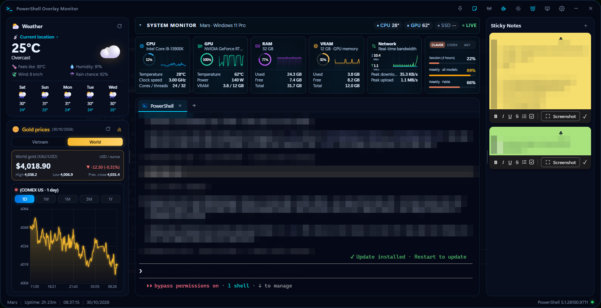

# DashShell — PowerShell Overlay Monitor

Ứng dụng Windows dạng overlay luôn nổi trên desktop: dashboard CPU / RAM / nhiệt độ / mạng realtime, **PowerShell
terminal thật** nhiều tab, ghi chú, theo dõi hạn mức Claude Code / Codex / Antigravity và báo qua Telegram khi agent
AI chạy xong.

Repo này chỉ chứa **bản cài đặt**.

## ⬇️ Tải về

**[Tải bản mới nhất](https://github.com/1995mars/dashshell-releases/releases/latest)** → trong mục *Assets*, chọn một
trong ba file:

| File | Dùng khi |
|---|---|
| `PowerShell-Overlay-Monitor_<phiên bản>_x64-setup.exe` | **Khuyến nghị** — bộ cài thường, có shortcut Start menu |
| `PowerShell-Overlay-Monitor_<phiên bản>_x64_en-US.msi` | Cài hàng loạt / qua chính sách công ty |
| `powershell-overlay-monitor.exe` | Bản portable, chạy luôn không cần cài |

## Yêu cầu hệ thống

- Windows 10 / 11, 64-bit.
- WebView2 Runtime (Windows 11 có sẵn; bộ cài tự tải nếu thiếu).
- Tuỳ chọn: PowerShell 7 (`winget install Microsoft.PowerShell`) — không có thì dùng Windows PowerShell 5.1.

## Tính năng

- **Dashboard realtime:** CPU (%, GHz, biểu đồ), RAM, nhiệt độ CPU / GPU NVIDIA / SSD, upload/download mạng.
- **Terminal PowerShell thật** (ConPTY): nhiều tab, màu ANSI, tiếng Việt, gợi ý lệnh kiểu VS Code.
- **Overlay:** luôn nổi, click-through (chuột xuyên qua), chỉnh độ trong suốt, nền Glass / Acrylic / Mica.
- **Hạn mức AI:** Claude Code (nhiều tài khoản), Codex, Antigravity — cùng số liệu với lệnh `/usage`.
- **Báo khi agent xong việc:** toast Windows + Telegram khi Claude Code / Codex / Antigravity xong lượt hoặc chờ xác
  nhận; điều khiển terminal từ Telegram (tuỳ chọn).
- Ghi chú, giá vàng trong nước / thế giới, hẹn giờ bật máy từ Sleep, thu xuống khay hệ thống.

## Cài đặt

1. Chạy file `..._x64-setup.exe` vừa tải.
2. Nếu Windows hiện **"Windows protected your PC"** (SmartScreen): bấm **More info → Run anyway**. Cảnh báo này xuất
   hiện vì bộ cài chưa có chứng chỉ ký mã thương mại.
3. Làm theo trình cài đặt, rồi mở **PowerShell Overlay Monitor** từ Start menu.

Bấm **X** chỉ thu app xuống khay hệ thống; muốn thoát hẳn: chuột phải icon ở khay → **Thoát**.

## Hướng dẫn Cài đặt (Settings)

Mở bằng icon bánh răng ⚙ trên thanh trên cùng. Mọi thay đổi **tự lưu ngay**, không có nút Lưu.

### General

| Tuỳ chọn | Ý nghĩa |
|---|---|
| Start with Windows | Tự mở app khi đăng nhập Windows. |
| Minimize to tray (khi bấm X) | Bấm X chỉ thu xuống khay hệ thống; tắt đi thì bấm X là thoát hẳn. |
| Remember window position | Mở lại đúng vị trí và kích thước cửa sổ lần trước. |
| Kiểm tra cập nhật | Kiểm tra bản mới (hiện cần tự tải ở trang [Releases](https://github.com/1995mars/dashshell-releases/releases)). |

### Overlay

| Tuỳ chọn | Ý nghĩa |
|---|---|
| Always on top | Cửa sổ luôn nổi trên các app khác (cũng bật/tắt bằng icon ghim trên thanh trên cùng). |
| Enable click-through overlay | Chuột bấm xuyên qua cửa sổ xuống app bên dưới. Muốn tắt: chuột phải icon ở khay → *Bật/Tắt Click-through*. |
| Opacity | Độ đậm của cửa sổ, 30–100%. |
| Background effect | Nền cửa sổ: Dark Glass (mặc định), Acrylic, Mica, Blur. |

### Monitoring

| Tuỳ chọn | Ý nghĩa |
|---|---|
| Refresh interval | Chu kỳ đọc phần cứng: 0.5 / 1 / 2 / 5 giây. Chậm hơn = nhẹ máy hơn. |
| Show SSD temperature | Hiện nhiệt độ SSD (cần chạy app bằng quyền Administrator). |
| Title + model / Ring percentage / Metric rows | Cỡ chữ tiêu đề, số % trong vòng tròn và các dòng số liệu trên card CPU / GPU / RAM / VRAM / Network. |
| CPU, GPU, RAM, VRAM, Network | Bật/tắt từng card. |
| AI usage limits | Card hạn mức Claude Code / Codex / Antigravity. Đổi nhà cung cấp bằng nút CLAUDE / CODEX / AGY trên card; bấm vào card để cập nhật ngay. Tắt đi thì app không gọi API nữa. |
| Usage refresh | Chu kỳ tự cập nhật hạn mức: 5 / 15 / 30 phút. |

Card hạn mức đọc tài khoản **đang đăng nhập trên máy** của Claude Code, Codex CLI và Antigravity CLI (`agy`) — không
cần nhập gì thêm. Chưa đăng nhập thì card hiện `--`.

### Widgets

| Tuỳ chọn | Ý nghĩa |
|---|---|
| Show weather | Thời tiết (Open-Meteo, 15 phút/lần); chọn thành phố ngay bên dưới. |
| Show gold prices | Giá vàng; đổi Trong nước / Thế giới trên card. |
| Show gold price chart | Biểu đồ giá vàng (bản 1D chỉ có dữ liệu từ lúc app chạy). |
| Đồng bộ Sticky Notes | Chọn một thư mục OneDrive / Google Drive / Dropbox (bấm **Dùng OneDrive** nếu có) để ghi chú giống nhau trên nhiều máy. Chọn **cùng một thư mục** trên mọi máy; lần đầu notes các máy được gộp lại. |

### Terminal

| Tuỳ chọn | Ý nghĩa |
|---|---|
| Font family / Font size / Cursor style | Phông, cỡ chữ, kiểu con trỏ của terminal (áp dụng ngay). |
| Shell path | Đường dẫn shell muốn dùng; để trống = PowerShell 7 nếu có, không thì Windows PowerShell. Áp dụng cho tab mới. |
| Gợi ý lệnh khi gõ | Popup gợi ý kiểu VS Code: `Tab` chèn, `↑↓` chọn, `Esc` đóng, `Ctrl+Space` mở ngay. |
| Thông báo khi agent xong lượt / cần xác nhận | Toast Windows khi Claude Code / Codex / Antigravity chạy trong tab DashShell xong việc. Bấm **Cài hook** cho từng agent ở các dòng bên dưới, rồi **mở tab mới**. Trên tab: chấm xoay = đang chạy, chấm xanh = xong, chấm vàng = đang chờ bạn. |

#### Telegram (trong tab Terminal)

1. Tạo bot bằng [@BotFather](https://t.me/BotFather) (`/newbot`), copy bot token.
2. Dán vào **Bot token** → **Lưu**. Token được cất trong Windows Credential Manager, không lưu ra file.
3. Nhắn `/start` cho bot trên Telegram → bấm **Lấy** để điền **Chat ID** → **Gửi thử**.
4. Bật **Gửi thông báo qua Telegram**.

| Tuỳ chọn | Ý nghĩa |
|---|---|
| Gửi thông báo qua Telegram | Agent trong tab DashShell xong việc → gửi tin (mặc định chỉ khi bạn không nhìn cửa sổ app). |
| Luôn gửi khi agent xong task | Gửi cả khi bạn đang xem app. |
| Đồng bộ Claude / Codex / AGY | Cài hook cho cả 3 agent trên máy: chạy ở **terminal bất kỳ** (kể cả khi DashShell đang tắt) cũng gửi Telegram khi xong task / chờ xác nhận. Đồng thời dặn agent dùng bot này khi bạn nhờ "xong thì báo Telegram", không hỏi lại token. Mở phiên agent mới sau khi bật. |
| Điều khiển terminal từ Telegram | **Tắt** · **Chỉ trả lời agent** — reply vào thông báo / ảnh màn hình để gõ câu trả lời (`1`, `y`, prompt…) vào đúng tab · **Toàn quyền** — gõ lệnh bất kỳ. Chỉ hoạt động khi app đang mở. |

Lệnh gửi cho bot:

| Lệnh | Chế độ | Tác dụng |
|---|---|---|
| `/help` | cả hai | Danh sách lệnh |
| `/tabs` | cả hai | Danh sách tab và trạng thái |
| `/screen [số tab]` | cả hai | Xem màn hình tab |
| `/key <tên>` (reply) | cả hai | Gửi phím: `enter`, `esc`, `up`, `down`, `tab`, `ctrlc`, `y`, `n`… |
| `/tab <số>` | Toàn quyền | Chọn tab để gõ lệnh |
| `/new [tên]` | Toàn quyền | Mở tab PowerShell mới |
| `/ctrlc`, `/esc`, `/enter` | Toàn quyền | Phím tắt cho tab đang chọn |
| chữ thường (không reply) | Toàn quyền | Chạy như lệnh trong tab đang chọn |

> ⚠️ **Toàn quyền** nghĩa là ai chiếm được tài khoản Telegram hoặc bot token của bạn đều chạy được lệnh trên máy.
> Bot chỉ nhận tin trong chat riêng của đúng chat ID đã cấu hình. Dùng nhiều máy thì mỗi máy nên có một bot riêng.

### Accounts

Dùng **nhiều tài khoản Claude Code** trên cùng máy. Mỗi tài khoản là một thư mục cấu hình riêng.

- **Thêm tài khoản:** nhập tên → **Thêm & đăng nhập**: mở tab mới chạy `claude`, hiện màn hình đăng nhập cho tài
  khoản mới. Nút **Đăng nhập** ở từng tài khoản làm tương tự (đã đăng nhập thì gõ `/login` để đổi).
- **Dùng:** chọn tài khoản cho các tab mở **sau đó** — cứ gõ `claude` như bình thường; tab đang mở giữ tài khoản cũ.
  Đổi nhanh: bấm nút CLAUDE trên card hạn mức.
- **Xoá:** chỉ bỏ khỏi danh sách, không xoá thư mục.

### Hẹn giờ bật máy (icon đồng hồ trên thanh trên cùng)

Đặt giờ để máy tự thức dậy từ **Sleep / Ngủ đông** (không bật được từ Shut down), có nút cho máy ngủ đông ngay.
Không cần quyền admin.

## Xử lý sự cố

| Vấn đề | Cách xử lý |
|---|---|
| Nhiệt độ CPU hiện `--` | Mainboard không có ACPI thermal zone. Kiểm tra: `Get-CimInstance Win32_PerfFormattedData_Counters_ThermalZoneInformation`. |
| Nhiệt độ SSD hiện `--` | Cần chạy app bằng **Run as Administrator**; một số ổ NVMe không hỗ trợ. |
| Bật click-through xong không bấm được app | Chuột phải icon ở khay → *Bật/Tắt Click-through*. |
| "An Application Control policy has blocked this file" | Smart App Control đang chặn file chưa ký: tắt trong Windows Security → App & browser control. |
| Terminal không mở | Đặt đường dẫn shell trong Settings → Terminal. |

## Gỡ cài đặt

**Settings → Apps → Installed apps → PowerShell Overlay Monitor → Uninstall.** Bản portable thì chỉ cần xoá file exe.
